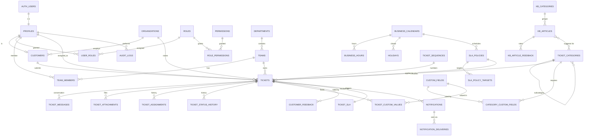

# DATABASE SCHEMA

Status: **design for approval** · Engine: Supabase PostgreSQL 15+ · Last updated: 2026-10-31

This document is the authoritative schema design. It is not yet a migration — SQL migrations will
be written in Phase 1 only after approval, and this document will be kept in sync with them.

---

## 1. Conventions

| Topic | Decision | Reason |
|---|---|---|
| Primary keys | `uuid` default `gen_random_uuid()` | Portable to SQL Server `uniqueidentifier`, safe to expose in URLs |
| Tenant key | none in v1 (single tenant); `organizations` exists for customer grouping | Avoids premature multi-tenancy |
| Timestamps | `timestamptz`, `created_at`/`updated_at` everywhere | Time-zone-safe SLA math |
| Soft delete | `deleted_at` only on reference data (categories, teams, articles, fields) | History must never lose a referenced row |
| Identifiers | `citext` for emails and ticket references | Case-insensitive uniqueness |
| Enums | native PG enum for closed value sets fixed by the brief | Checked at DB level; mapped to lookup tables in SQL Server |
| Free-form data | `jsonb` only for custom-field values, settings and audit payload | Never for relational data |
| Naming | `snake_case`, plural tables, singular FK columns (`team_id`) | Predictable, portable |
| Money/metrics | `numeric` for durations in seconds (`integer`), never floats | Exact SLA comparisons |
| Text | `text` + `CHECK (char_length(...))` rather than `varchar(n)` | No silent truncation |

**Actor columns.** Every mutable business table records `created_by` and, where relevant,
`updated_by` referencing `profiles(id)` with `ON DELETE RESTRICT`.

---

## 2. Entity-relationship diagram



`AUTH_USERS` is Supabase's `auth.users`, owned by GoTrue; `PROFILES` mirrors it and is the table
the application joins against.

---

## 3. Table catalog

25 business tables + 3 infrastructure tables. Each row in the brief's entity list is either
mapped to a table here or explicitly folded in — no table exists that is not used.

| # | Table | Purpose | Soft delete | RLS |
|---|---|---|---|---|
| 1 | `profiles` | One row per authenticated user (customer or staff) | no | yes |
| 2 | `roles` | Role catalog (5 roles) | no | read-only for staff |
| 3 | `permissions` | Permission code catalog | no | read-only for staff |
| 4 | `role_permissions` | Role → permission grants | no | admin |
| 5 | `user_roles` | User → role grants, with grant metadata | no | admin |
| 6 | `organizations` | Customer companies | yes | member/admin |
| 7 | `customers` | Customer profile detail (1:1 with profile) | no | self/admin |
| 8 | `departments` | Top-level internal grouping | yes | staff |
| 9 | `teams` | Ticket-owning team; assignable queue | yes | member/admin |
| 10 | `team_members` | Membership + team role (member/leader) | no | team |
| 11 | `ticket_categories` | Self-referencing category/subcategory tree | yes | public read |
| 12 | `custom_fields` | Custom field definitions | yes | public read (active) |
| 13 | `category_custom_fields` | Which fields apply to which category, order, required | no | public read (active) |
| 14 | `tickets` | Ticket header | no | customer/team |
| 15 | `ticket_custom_values` | One row per ticket × field | no | customer/team |
| 16 | `ticket_messages` | Public replies **and** internal notes (single table, `visibility`) | no | customer: public only |
| 17 | `ticket_attachments` | Files, nullable message link | no | customer: public only |
| 18 | `ticket_assignments` | Immutable assignment history | no | customer: no |
| 19 | `ticket_status_history` | Immutable status transition log | no | customer: own |
| 20 | `ticket_sla` | Current SLA state per ticket (1:1) | no | customer: summary only |
| 21 | `sla_policies` | Policy header + selection rules | yes | staff read, admin write |
| 22 | `sla_policy_targets` | Priority × metric targets | no | staff read |
| 23 | `business_calendars` | Named calendar + time zone | yes | staff |
| 24 | `business_hours` | Weekly working windows per calendar | no | staff |
| 25 | `holidays` | Closed dates per calendar | no | staff |
| 26 | `customer_feedback` | CSAT, resolution confirmation/rejection, reopen reason | no | customer own |
| 27 | `kb_categories` | Knowledgebase categories | yes | public read (published) |
| 28 | `kb_articles` | Bilingual articles | yes | public read (published) |
| 29 | `kb_article_feedback` | Helpful / not helpful votes | no | own |
| 30 | `notifications` | In-app notifications | no | owner |
| 31 | `notification_deliveries` | Email outbox + attempts | no | staff |
| 32 | `audit_logs` | Immutable audit trail | no | admin read |
| 33 | `app_settings` | Key/value system configuration | no | admin |
| 34 | `rate_limits` | Fixed-window counters (infrastructure) | no | none (service only) |
| 35 | `job_runs` | Cron job execution log (infrastructure) | no | admin |
| 36 | `ticket_sequences` | Per-year reference counters (infrastructure) | no | none (service only) |

### Deliberate deviations from the brief's entity list

- **`ticket_internal_notes` is not a separate table.** Internal notes and public replies share
  `ticket_messages` with a `visibility` enum. A separate table would duplicate body/author/created_at
  and attachments would need two nullable FKs. Protection is achieved by RLS + a restricted view,
  not by table separation; this is tested explicitly (see SECURITY_AND_RLS §6).
- **`tickets.sla_record` is not denormalized into `tickets`.** SLA state changes on a different
  cadence (cron) than the ticket, and keeping it separate avoids ticket-row contention.
- **`kb_articles` is bilingual in one table** (`title_en`/`title_ar`), not a translation table —
  only two languages are required; a translation table adds joins with no benefit.
- **`organizations` exists but organization-level shared access is OFF by default** and is an open
  decision (see OPEN_DECISIONS D-04).

---

## 4. Core table definitions

Types below are design-level; the migration will add `NOT NULL`, `CHECK`, `DEFAULT` and indexes
exactly as shown or stricter. Enum names are given in `DATA_DICTIONARY.md`.

### 4.1 Identity and access

```sql
create table profiles (
  id               uuid primary key references auth.users(id) on delete restrict,
  email            citext not null,
  full_name        text not null check (char_length(full_name) between 1 and 120),
  phone            text check (phone is null or phone ~ '^\+?[0-9 \-()]{7,20}$'),
  locale           text not null default 'en' check (locale in ('en','ar')),
  timezone         text not null default 'Asia/Riyadh',
  avatar_url       text,
  account_status   account_status not null default 'active',   -- pending|active|suspended|deactivated
  is_staff         boolean not null default false,             -- derived, trigger-maintained
  email_verified_at timestamptz,
  last_login_at    timestamptz,
  created_at       timestamptz not null default now(),
  updated_at       timestamptz not null default now(),
  unique (email)
);

create table roles (
  id          uuid primary key default gen_random_uuid(),
  code        role_code not null unique,          -- customer|agent|team_leader|admin|management_viewer
  name_en     text not null,
  name_ar     text not null,
  is_internal boolean not null default true
);

create table permissions (
  id          uuid primary key default gen_random_uuid(),
  code        text primary key,                   -- e.g. 'ticket.assign.team'
  description text not null
);

create table role_permissions (
  role_id       uuid not null references roles(id) on delete cascade,
  permission_id uuid not null references permissions(id) on delete cascade,
  primary key (role_id, permission_id)
);

create table user_roles (
  user_id     uuid not null references profiles(id) on delete cascade,
  role_id     uuid not null references roles(id) on delete restrict,
  granted_by  uuid references profiles(id),
  granted_at  timestamptz not null default now(),
  primary key (user_id, role_id)
);

create table organizations (
  id          uuid primary key default gen_random_uuid(),
  name        text not null check (char_length(name) between 1 and 160),
  code        citext unique,
  domain      citext unique,                      -- optional email-domain auto-join; OFF by default
  share_tickets boolean not null default false,   -- organization-wide visibility; OFF by default
  is_active   boolean not null default true,
  created_at  timestamptz not null default now(),
  updated_at  timestamptz not null default now(),
  deleted_at  timestamptz
);

create table customers (
  profile_id       uuid primary key references profiles(id) on delete cascade,
  organization_id  uuid references organizations(id) on delete set null,
  job_title        text,
  company_name     text,                          -- free text when no organization record
  preferred_contact text not null default 'email' check (preferred_contact in ('email','phone')),
  notes_internal   text,                          -- staff-only, never exposed to customer
  registered_at    timestamptz not null default now(),
  updated_at       timestamptz not null default now()
);
```

### 4.2 Teams

```sql
create table departments (
  id uuid primary key default gen_random_uuid(),
  name_en text not null, name_ar text not null,
  is_active boolean not null default true,
  created_at timestamptz not null default now(), deleted_at timestamptz
);

create table teams (
  id uuid primary key default gen_random_uuid(),
  department_id uuid not null references departments(id) on delete restrict,
  code citext not null unique,
  name_en text not null, name_ar text not null,
  description text,
  email citext,                                   -- team mailbox for notifications
  is_default boolean not null default false,      -- fallback team for unassigned tickets
  is_active boolean not null default true,
  created_at timestamptz not null default now(), updated_at timestamptz not null default now(),
  deleted_at timestamptz
);
create unique index teams_one_default on teams ((is_default)) where is_default;

create table team_members (
  team_id uuid not null references teams(id) on delete cascade,
  user_id uuid not null references profiles(id) on delete cascade,
  team_role team_role not null default 'member',  -- member|leader
  is_active boolean not null default true,
  joined_at timestamptz not null default now(),
  primary key (team_id, user_id)
);
```

### 4.3 Categories and custom fields

```sql
create table ticket_categories (
  id uuid primary key default gen_random_uuid(),
  parent_id uuid references ticket_categories(id) on delete restrict,
  code citext not null unique,
  name_en text not null, name_ar text not null,
  description_en text, description_ar text,
  default_team_id uuid references teams(id) on delete set null,
  default_priority priority_level,
  sla_policy_id uuid references sla_policies(id) on delete set null,
  sort_order integer not null default 0,
  is_active boolean not null default true,
  created_at timestamptz not null default now(), updated_at timestamptz not null default now(),
  deleted_at timestamptz,
  check (parent_id is null or sort_order >= 0)
);
-- Depth is limited to 2 by trigger: a subcategory may not itself have a parent.

create table custom_fields (
  id uuid primary key default gen_random_uuid(),
  code citext not null unique,
  label_en text not null, label_ar text not null,
  field_type custom_field_type not null,
  help_text_en text, help_text_ar text,
  options jsonb,                                  -- [{value,label_en,label_ar}] for list types
  validation jsonb,                               -- {min,max,minLength,maxLength,pattern,extensions,maxBytes}
  is_active boolean not null default true,
  created_at timestamptz not null default now(), updated_at timestamptz not null default now(),
  deleted_at timestamptz,
  check (field_type not in ('dropdown','multiselect','radio') or options is not null)
);

create table category_custom_fields (
  category_id uuid not null references ticket_categories(id) on delete cascade,
  field_id uuid not null references custom_fields(id) on delete restrict,
  is_required boolean not null default false,
  visible_to_customer boolean not null default true,
  sort_order integer not null default 0,
  primary key (category_id, field_id)
);
```

### 4.4 Tickets

```sql
create table tickets (
  id uuid primary key default gen_random_uuid(),
  reference citext not null unique,               -- CTS-2026-000001
  customer_id uuid not null references customers(profile_id) on delete restrict,
  organization_id uuid references organizations(id) on delete set null,
  category_id uuid not null references ticket_categories(id) on delete restrict,
  subcategory_id uuid references ticket_categories(id) on delete restrict,
  subject text not null check (char_length(subject) between 3 and 200),
  description text not null check (char_length(description) between 10 and 20000),
  status ticket_status not null default 'new',
  priority priority_level not null default 'normal',
  channel ticket_channel not null default 'web_portal',
  team_id uuid references teams(id) on delete set null,
  assignee_id uuid references profiles(id) on delete set null,
  locale text not null default 'en' check (locale in ('en','ar')),
  source_ip inet,
  first_response_at timestamptz,                  -- set on first staff public reply
  last_public_reply_at timestamptz,
  last_customer_reply_at timestamptz,
  resolved_at timestamptz,
  resolution_summary text,
  closed_at timestamptz,
  reopened_count smallint not null default 0,
  escalation_level smallint not null default 0,   -- 0 none, 1 leader, 2 admin
  search_document tsvector generated always as (
    to_tsvector('simple', coalesce(subject,'') || ' ' || coalesce(description,''))
  ) stored,
  created_at timestamptz not null default now(),
  updated_at timestamptz not null default now(),
  constraint resolved_requires_summary check (status <> 'resolved' or resolution_summary is not null)
);

create index tickets_customer_idx  on tickets (customer_id, created_at desc);
create index tickets_queue_idx     on tickets (team_id, status, priority, created_at desc);
create index tickets_assignee_idx  on tickets (assignee_id, status);
create index tickets_org_idx       on tickets (organization_id) where organization_id is not null;
create index tickets_search_idx    on tickets using gin (search_document);

create table ticket_messages (
  id uuid primary key default gen_random_uuid(),
  ticket_id uuid not null references tickets(id) on delete cascade,
  author_id uuid not null references profiles(id) on delete restrict,
  author_kind message_author_kind not null,       -- customer|agent|system
  visibility message_visibility not null,         -- public|internal
  body text not null check (char_length(body) between 1 and 20000),
  body_locale text check (body_locale in ('en','ar')),
  is_initial_description boolean not null default false,
  created_at timestamptz not null default now(),
  edited_at timestamptz,
  constraint internal_note_is_staff_only check (visibility = 'public' or author_kind = 'agent')
);
create index ticket_messages_ticket_idx on ticket_messages (ticket_id, created_at);

create table ticket_attachments (
  id uuid primary key default gen_random_uuid(),
  ticket_id uuid not null references tickets(id) on delete cascade,
  message_id uuid references ticket_messages(id) on delete cascade,
  uploader_id uuid not null references profiles(id) on delete restrict,
  visibility message_visibility not null default 'public',
  storage_path text not null unique,              -- tickets/{ticket_id}/{uuid}.{ext}
  file_name text not null,
  mime_type text not null,
  size_bytes integer not null check (size_bytes between 1 and 10485760),
  checksum_sha256 text,
  created_at timestamptz not null default now()
);
create index ticket_attachments_ticket_idx on ticket_attachments (ticket_id);

create table ticket_assignments (
  id uuid primary key default gen_random_uuid(),
  ticket_id uuid not null references tickets(id) on delete cascade,
  team_id uuid references teams(id) on delete set null,
  assignee_id uuid references profiles(id) on delete set null,
  assignment_type assignment_type not null,       -- initial|reassign|escalate|unassign|auto
  reason text,
  assigned_by uuid not null references profiles(id) on delete restrict,
  created_at timestamptz not null default now()
);

create table ticket_status_history (
  id uuid primary key default gen_random_uuid(),
  ticket_id uuid not null references tickets(id) on delete cascade,
  from_status ticket_status,
  to_status ticket_status not null,
  changed_by uuid references profiles(id) on delete set null,  -- null = system
  reason text,
  created_at timestamptz not null default now()
);

create table ticket_custom_values (
  ticket_id uuid not null references tickets(id) on delete cascade,
  field_id uuid not null references custom_fields(id) on delete restrict,
  value_text text, value_number numeric, value_date date,
  value_boolean boolean, value_json jsonb, value_file_id uuid references ticket_attachments(id),
  primary key (ticket_id, field_id)
);

create table ticket_sla (
  ticket_id uuid primary key references tickets(id) on delete cascade,
  policy_id uuid not null references sla_policies(id) on delete restrict,
  first_response_due_at timestamptz not null,
  resolution_due_at timestamptz not null,
  first_response_met_at timestamptz,
  resolution_met_at timestamptz,
  state sla_state not null default 'on_track',     -- on_track|due_soon|breached|paused|completed
  paused_at timestamptz,
  total_paused_seconds integer not null default 0,
  warning_sent_at timestamptz,
  breach_notified_at timestamptz,
  updated_at timestamptz not null default now()
);
create index ticket_sla_due_idx on ticket_sla (state, first_response_due_at, resolution_due_at);
```

### 4.5 SLA configuration

```sql
create table business_calendars (
  id uuid primary key default gen_random_uuid(),
  code citext not null unique,
  name_en text not null, name_ar text not null,
  timezone text not null default 'Asia/Riyadh',
  is_active boolean not null default true,
  created_at timestamptz not null default now(), deleted_at timestamptz
);

create table business_hours (
  id uuid primary key default gen_random_uuid(),
  calendar_id uuid not null references business_calendars(id) on delete cascade,
  day_of_week smallint not null check (day_of_week between 0 and 6),  -- 0 = Sunday
  start_time time not null, end_time time not null,
  check (start_time < end_time)
);

create table holidays (
  id uuid primary key default gen_random_uuid(),
  calendar_id uuid not null references business_calendars(id) on delete cascade,
  holiday_date date not null,
  name_en text not null, name_ar text not null,
  is_recurring boolean not null default false,
  unique (calendar_id, holiday_date)
);

create table sla_policies (
  id uuid primary key default gen_random_uuid(),
  code citext not null unique,
  name_en text not null, name_ar text not null,
  calendar_id uuid not null references business_calendars(id) on delete restrict,
  team_id uuid references teams(id) on delete set null,
  category_id uuid references ticket_categories(id) on delete set null,
  is_default boolean not null default false,
  pause_on_pending_customer boolean not null default true,
  pause_on_pending_internal boolean not null default false,   -- must never default to true
  warning_threshold_pct smallint not null default 80 check (warning_threshold_pct between 10 and 100),
  escalate_at_pct smallint not null default 100 check (escalate_at_pct between 50 and 200),
  is_active boolean not null default true,
  created_at timestamptz not null default now(), updated_at timestamptz not null default now(),
  deleted_at timestamptz,
  check (not (team_id is not null and category_id is not null) or true)
);

create table sla_policy_targets (
  policy_id uuid not null references sla_policies(id) on delete cascade,
  priority priority_level not null,
  first_response_minutes integer not null check (first_response_minutes between 1 and 20160),
  resolution_minutes   integer not null check (resolution_minutes between 5 and 100800),
  primary key (policy_id, priority),
  check (resolution_minutes >= first_response_minutes)
);
```

### 4.6 Feedback, knowledgebase, notifications, audit

```sql
create table customer_feedback (
  id uuid primary key default gen_random_uuid(),
  ticket_id uuid not null references tickets(id) on delete cascade,
  customer_id uuid not null references customers(profile_id) on delete restrict,
  feedback_type feedback_type not null,           -- resolution_confirm|resolution_reject|csat
  rating smallint check (rating between 1 and 5),
  comment text check (char_length(comment) <= 2000),
  rejection_reason text,
  created_at timestamptz not null default now(),
  constraint feedback_shape check (
    (feedback_type = 'csat' and rating is not null) or
    (feedback_type <> 'csat' and rating is null)
  )
);
create unique index customer_feedback_one_resolution on customer_feedback (ticket_id, feedback_type)
  where feedback_type in ('resolution_confirm','resolution_reject');

create table kb_categories (
  id uuid primary key default gen_random_uuid(),
  parent_id uuid references kb_categories(id) on delete restrict,
  slug citext not null unique,
  name_en text not null, name_ar text not null,
  sort_order integer not null default 0,
  is_active boolean not null default true,
  created_at timestamptz not null default now(), deleted_at timestamptz
);

create table kb_articles (
  id uuid primary key default gen_random_uuid(),
  category_id uuid not null references kb_categories(id) on delete restrict,
  slug citext not null unique,
  title_en text not null, title_ar text not null,
  body_en text not null, body_ar text not null,
  visibility kb_visibility not null default 'public',   -- public|internal
  status kb_status not null default 'draft',           -- draft|published|archived
  published_at timestamptz,
  view_count integer not null default 0,
  helpful_count integer not null default 0,
  not_helpful_count integer not null default 0,
  search_document tsvector generated always as (
    to_tsvector('simple', coalesce(title_en,'') || ' ' || coalesce(title_ar,'') || ' ' ||
                            coalesce(body_en,'')  || ' ' || coalesce(body_ar,''))
  ) stored,
  created_by uuid references profiles(id) on delete set null,
  created_at timestamptz not null default now(), updated_at timestamptz not null default now(),
  deleted_at timestamptz
);
create index kb_articles_search_idx on kb_articles using gin (search_document);

create table kb_category_links (
  article_id uuid not null references kb_articles(id) on delete cascade,
  category_id uuid not null references ticket_categories(id) on delete cascade,
  primary key (article_id, category_id)
);

create table kb_article_feedback (
  article_id uuid not null references kb_articles(id) on delete cascade,
  user_id uuid not null references profiles(id) on delete cascade,
  is_helpful boolean not null,
  created_at timestamptz not null default now(),
  primary key (article_id, user_id)
);

create table notifications (
  id uuid primary key default gen_random_uuid(),
  user_id uuid not null references profiles(id) on delete cascade,
  ticket_id uuid references tickets(id) on delete cascade,
  event notification_event not null,
  title_en text not null, title_ar text not null,
  body_en text not null, body_ar text not null,
  link_url text,
  read_at timestamptz,
  created_at timestamptz not null default now()
);
create index notifications_user_idx on notifications (user_id, read_at, created_at desc);

create table notification_deliveries (
  id uuid primary key default gen_random_uuid(),
  notification_id uuid references notifications(id) on delete set null,
  template_code text not null,
  recipient_email citext not null,
  locale text not null check (locale in ('en','ar')),
  payload jsonb not null default '{}'::jsonb,
  dedupe_key text unique,                          -- prevents duplicate sends per business event
  status delivery_status not null default 'queued',-- queued|sending|sent|failed|suppressed
  attempts smallint not null default 0,
  next_attempt_at timestamptz not null default now(),
  last_error text,
  sent_at timestamptz,
  created_at timestamptz not null default now()
);
create index notification_deliveries_queue_idx on notification_deliveries (status, next_attempt_at);

create table audit_logs (
  id bigint generated always as identity primary key,
  actor_id uuid references profiles(id) on delete set null,
  actor_role text,
  action text not null,                            -- ticket.status_changed, user.role_granted, ...
  entity_type text not null,
  entity_id uuid,
  before jsonb, after jsonb,
  request_id text, ip inet, user_agent text,
  created_at timestamptz not null default now()
);
create index audit_logs_entity_idx on audit_logs (entity_type, entity_id, created_at desc);
create index audit_logs_actor_idx  on audit_logs (actor_id, created_at desc);

create table app_settings (
  key text primary key,
  value jsonb not null,
  description text,
  updated_by uuid references profiles(id) on delete set null,
  updated_at timestamptz not null default now()
);
```

Infrastructure tables (not exposed through the API layer at all):

```sql
create table ticket_sequences (
  year smallint primary key,
  last_value bigint not null default 0
);

create table rate_limits (
  bucket text not null,            -- e.g. 'ticket.create:<user_id>'
  window_start timestamptz not null,
  counter integer not null default 0,
  primary key (bucket, window_start)
);

create table job_runs (
  id uuid primary key default gen_random_uuid(),
  job_name text not null,
  started_at timestamptz not null default now(),
  finished_at timestamptz,
  status job_status not null default 'running',
  processed integer not null default 0,
  failed integer not null default 0,
  detail jsonb
);
```

---

## 5. Concurrency-safe ticket reference

`CTS-{year}-{6-digit}` from a per-year counter, allocated inside the same transaction that inserts
the ticket:

```sql
create or replace function app.next_ticket_reference(p_year smallint)
returns citext
language plpgsql
security definer
set search_path = public, pg_temp
as $$
declare v_next bigint;
begin
  insert into ticket_sequences (year, last_value)
  values (p_year, 1)
  on conflict (year) do update set last_value = ticket_sequences.last_value + 1
  returning last_value into v_next;

  return format('CTS-%s-%s', p_year, lpad(v_next::text, 6, '0'))::citext;
end;
$$;
```

`INSERT … ON CONFLICT DO UPDATE` takes a row lock for the duration of the transaction, so two
concurrent submissions serialize on the counter and receive distinct numbers. The counter never
decreases (no reuse after deletion) and `tickets.reference` additionally has a `UNIQUE` constraint
as a final guard. Verified under concurrency by a pgTAP test that submits 200 tickets in parallel
and asserts 200 distinct references with no gaps in allocation order.

Why not `bigserial`: a sequence would also be safe, but it cannot reset per year and cannot be
inspected per year for reporting. Why not `count(*) + 1`: race condition.

---

## 6. Triggers (business invariants enforced in the database)

| Trigger | Table | Effect |
|---|---|---|
| `trg_tickets_updated_at` | many | sets `updated_at = now()` |
| `trg_tickets_protect_reference` | `tickets` | raises if `reference` changes |
| `trg_tickets_status_transition` | `tickets` | rejects any status change not in the allowed matrix (backend for `domain/transitions.ts`) |
| `trg_tickets_stamp_timestamps` | `tickets` | sets `resolved_at`/`closed_at`, bumps `reopened_count` |
| `trg_tickets_assignee_scope` | `tickets` | assignee must be an active member of `team_id` (or admin actor) |
| `trg_tickets_audit` | `tickets` | writes `audit_logs` for status/priority/assignee/team changes |
| `trg_messages_normalize` | `ticket_messages` | customers can only insert `visibility='public'` |
| `trg_profiles_sync_staff` | `profiles` | recomputes `is_staff` from `user_roles` |
| `trg_category_depth` | `ticket_categories` | blocks depth > 2 |
| `trg_org_domain_unique` | `organizations` | keeps `domain` unique when set |

RLS is the authorization layer; triggers are integrity — they are not substitutes for each other.

---

## 7. Views and RPC functions

**Views** (all `security_invoker = true`, so the caller's RLS applies):

| View | Purpose |
|---|---|
| `v_customer_tickets` | Ticket header + category/team names + unread count, no staff-only columns |
| `v_ticket_conversation` | Public messages + attachments for customer UI |
| `v_ticket_conversation_internal` | Everything, staff only (RLS on underlying table still applies) |
| `v_agent_workload` | Per-agent open/in-progress/overdue counts |
| `v_sla_dashboard` | Tickets with state, remaining seconds, breach flags |

**RPCs** (`security definer`, each re-checks `auth.uid()` and permissions explicitly):

| Function | Purpose |
|---|---|
| `app.create_ticket(payload jsonb)` | reference + SLA + history + custom values in one transaction |
| `app.add_message(p_ticket_id, p_body, p_visibility)` | enforces visibility rule, updates timestamps + SLA pause/resume |
| `app.transition_ticket(p_ticket_id, p_to, p_reason)` | matrix check + history + timestamps |
| `app.assign_ticket(p_ticket_id, p_team_id, p_assignee_id, p_type, p_reason)` | scope validation + history + audit |
| `app.compute_sla_due_dates(p_policy_id, p_priority, p_start)` | business-calendar-aware deadline math |
| `app.refresh_sla_state(p_ticket_id)` | recompute state/pauses for one ticket |
| `app.sweep_sla()` | batch pass for the cron job; returns counts |
| `app.consume_rate_limit(p_bucket, p_limit, p_window_seconds)` | fixed-window counter, returns bool |
| `app.report_*` (Phase 7) | aggregate KPI queries |

Business-critical writes go through RPCs so multi-row invariants cannot be half-applied, and the
same functions become the specification for the future .NET services.

---

## 8. Indexing and performance notes

- Ticket list queries are always `(scope) + status + sort by created_at`; covered by
  `tickets_queue_idx` / `tickets_customer_idx`.
- Full-text search uses `simple` configuration (language-agnostic, works for Arabic script and
  mixed content) with a trigram index as fallback for short partial terms.
- `ticket_messages` and `audit_logs` are append-only and can be range-partitioned by month later
  without schema change to dependants; not partitioned in v1 (volume does not justify it).
- All lists are paginated server-side (30/page default, 100 max) — no unbounded query is allowed.

---

## 9. Migration strategy

- Version-controlled SQL in `supabase/migrations/NNNN_description.sql`, forward-only.
- Each migration is reviewed for destructive operations; `DROP` of a populated column is not
  permitted in v1 — deprecate first.
- `supabase db diff` is used to generate candidates, but every migration is hand-reviewed; generated
  SQL is never pushed blind.
- Seed data (roles, permissions, default calendar, default SLA policy, categories) lives in
  `supabase/seed.sql` and is idempotent.
- RLS tests (pgTAP) run against a disposable database in CI.

---

## 10. Data dictionary

Enumerations, column semantics, nullability and validation rules are in
[DATA_DICTIONARY.md](DATA_DICTIONARY.md). Relationship cardinality, cascade behaviour and per-flow
data touchpoints are in [DATABASE_RELATIONSHIPS.md](DATABASE_RELATIONSHIPS.md).
